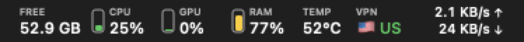
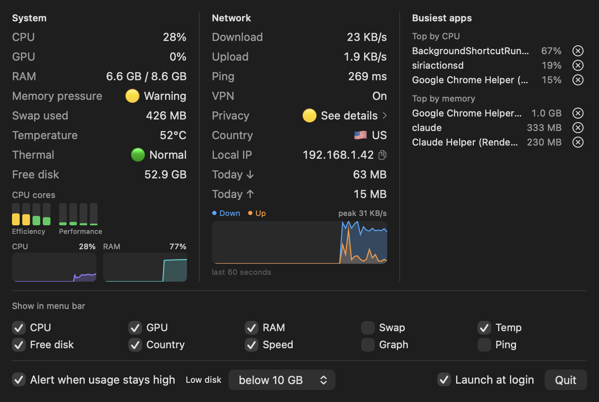

# QuickStatMenu

A small macOS menu bar app, written in SwiftUI, that shows what your Mac is doing at a glance: CPU, GPU, RAM, temperature, free disk space, network speed and where your traffic appears to come from.

by persuara



Click the menu bar item to open the full panel:



## Features

**In the menu bar** (each item can be switched on or off)

- Free disk space
- CPU, GPU and RAM as colored column bars with a percentage. CPU and GPU go green, yellow, orange, red with load. RAM follows macOS memory pressure instead.
- SoC temperature in °C
- Country of your public IP, with a flag. It turns green and reads `VPN` when a VPN tunnel is up.
- Download and upload speed
- Optional: swap used, ping, and a small network graph

**In the panel**

- System: CPU, GPU, RAM, memory pressure, swap, temperature, thermal state, free disk, per-core CPU bars (efficiency and performance cores), 60-second CPU and RAM graphs
- Network: speeds, ping, VPN state, privacy check, country, local IP (click to copy), traffic used today, 60-second download and upload graph
- Busiest apps: top 3 by CPU and by memory, with Quit and Force Quit
- Notifications when CPU, memory pressure, temperature or throttling stay high for a while, and when free disk space drops below a threshold you choose
- Launch at login toggle

**Privacy check**

Click the Privacy row to see:

- the IP address websites see, who owns it, and whether it is a known VPN range
- DNS leaks: whether your DNS servers are reached inside the VPN tunnel
- IPv6 leaks: whether a public IPv6 address on your Wi-Fi or Ethernet bypasses the VPN
- whether your Mac's time zone matches your exit location

It cannot detect browser (WebRTC) leaks, and it cannot tell you whether any company has flagged you.

## Requirements

- macOS 13 or later
- Xcode or the Command Line Tools (`xcode-select --install`) with Swift 5.9 or later

## Setup

```bash
git clone https://github.com/persuara/QuickStatMenu.git
cd QuickStatMenu
./build.sh
open /Applications/MenuStats.app
```

`build.sh` builds a release binary, wraps it in `MenuStats.app` (menu bar only, no Dock icon), signs it ad hoc, and installs it into `/Applications`, replacing any older copy. It also quits a running copy first, so run `open /Applications/MenuStats.app` afterwards.

On first launch:

- The app registers itself to start at login. Turn this off with the "Launch at login" toggle in the panel, or under System Settings, General, Login Items.
- macOS asks once whether MenuStats may send notifications. Allow it if you want alerts.

## Using it

- Click the menu bar item to open the panel.
- Use "Show in menu bar" in the panel to choose which items appear. Your choices are saved.
- If every item is switched off, a small chart icon stays so you can still reach the panel.
- Use the ✕ next to an app in "Busiest apps" to quit it. Force Quit asks for confirmation first. System processes and a few protected ones are never offered.

## What the app contacts

Nothing is sent except anonymous requests that reveal your public IP to the service you call:

| Purpose | Service | How often |
| --- | --- | --- |
| Country of your public IP | `ipinfo.io` | every 60 seconds, and when the VPN state changes |
| Privacy check | `api.ipify.org`, `api6.ipify.org` (only if you have a public IPv6 address), `proxycheck.io` | at startup, when the VPN changes, and every 10 minutes |
| Ping | one ICMP echo to `1.1.1.1` | every 5 seconds |

Traffic totals for today are stored locally in the app's preferences. Nothing else leaves your Mac.

## Notes

- The temperature is read through Apple's private IOHID sensor interface, which is the only way to read thermal sensors on Apple Silicon. It works for a locally built app but cannot be used in an App Store app, and a future macOS update could change it. If no sensor is found, the temperature is hidden in the menu bar and shows `N/A` in the panel.
- Memory used matches Activity Monitor: app memory plus wired plus compressed.
- Free disk space includes purgeable space, so it matches Finder rather than `df`.
- "Today" traffic only counts while the app is running.
- VPN detection looks for an active tunnel interface (`utun`, `ppp`, `ipsec`, `tun`, `tap`) with a routable address.

## Rebuilding the icon

```bash
swift tools/make-icon.swift
iconutil -c icns Resources/AppIcon.iconset -o Resources/AppIcon.icns
rm -rf Resources/AppIcon.iconset
```

## Uninstall

1. Turn off "Launch at login" in the panel, then click Quit.
2. Delete `/Applications/MenuStats.app`.
3. Optionally remove saved settings: `defaults delete com.local.MenuStats`

## Project layout

| File | What it does |
| --- | --- |
| `MenuStatsApp.swift` | App entry point and the drop-down panel |
| `MenuBarLabel.swift` | Draws the menu bar item |
| `SystemMonitor.swift` | Samples CPU, GPU, RAM, disk, network, processes, VPN, ping |
| `Temperature.swift` | Reads the SoC temperature |
| `NetworkGraph.swift`, `CoreBars.swift` | Graphs and per-core bars |
| `Alerts.swift` | Notifications and the process list model |
| `PrivacyCheck.swift` | Privacy check and its window |
| `LaunchAtLogin.swift` | Login item registration |

## License

MIT, see [LICENSE](LICENSE).
